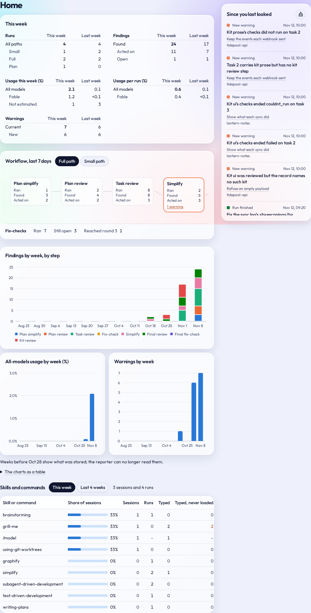

# edward

Edward is a live, local dashboard for a Claude Code agentic workflow. It runs the workflow's reporter, `workflow-report.py --json --changed-since <cursor>`, on start, whenever the workflow's run log changes, every 15 minutes when a session transcript changed, and on the page's refresh button, keeps every import in a local SQLite database, and shows what the reporter says: runs by path, the findings each review step raised and acted on, warnings, and estimated spend, week by week.



The screenshot is one of the screenshot-test baselines, on invented data. The repo holds code and invented fixtures only; the real data is read at run time on your own machine and never leaves it. In local mode the server listens on `127.0.0.1` only.

## Requirements

- macOS or Linux (the dashboard runs as a launchd agent or a systemd user unit); on Windows, through WSL with systemd turned on (`systemd=true` under `[boot]` in `/etc/wsl.conf`).
- Node 22.18 or later (see `.nvmrc`): Node runs the server's TypeScript directly.
- pnpm, the version in `package.json`'s `packageManager` (for example through `corepack enable`).
- The workflow's reporter installed at `~/.claude/scripts/workflow-report.py`, printing JSON version 1 and accepting CR6's `--changed-since` (a reporter before CR6 rejects it, so every import fails). Without it, each import fails with a banner naming the missing command.

## Install

```sh
pnpm install
pnpm build
pnpm agent:install
```

`pnpm build` builds the web app, which the server serves. `pnpm agent:install` starts the server with the `node` that ran the command and keeps it running: on macOS it writes a launchd agent to `~/Library/LaunchAgents/com.shoklah.claude-workflow-dashboard.plist`, which starts at login; on Linux it writes a systemd user unit to `~/.config/systemd/user/claude-workflow-dashboard.service` and enables it, and the unit runs while you are logged in unless you run `loginctl enable-linger`. The dashboard is then at <http://localhost:4317>.

`pnpm agent:uninstall` stops the agent and deletes its file. To reinstall (after moving the repo or changing Node), uninstall first.

## Collector

The collector runs the reporter on this machine and sends its export to a hosted edward, which shows it.

1. Create a token on the hosted edward's Account page.
2. Put it in the data folder's `.env` as `EDWARD_TOKEN=…`.
3. Write `collector.json` in the data folder: `{ "mode": "collector", "server": "https://…" }`, the hosted edward's address.
4. Run `pnpm agent:install --collector`.

On macOS it writes a launchd agent to `~/Library/LaunchAgents/com.shoklah.claude-workflow-dashboard.collector.plist`, on Linux a systemd user unit to `~/.config/systemd/user/claude-workflow-dashboard-collector.service`; it logs into the data folder's `logs/collector/`. `pnpm agent:uninstall --collector` stops it and deletes its file. The local server's agent and the collector's can run side by side.

## Hosted

A hosted edward serves several accounts, each signing in with GitHub (invite-only) and fed by its own collector. It runs as a Docker container behind a reverse proxy that serves HTTPS.

1. Create a GitHub OAuth app whose callback URL is `https://<host>/auth/github/callback`.
2. On the server, in the repo's `deploy/` folder, create the data folder: `mkdir -p data/claude-workflow-dashboard`.
3. In `data/claude-workflow-dashboard/`, write `config.json` as `{ "mode": "hosted" }` and a `.env` with:
   - `EDWARD_PUBLIC_HOST`: the public hostname, `<host>`;
   - `GITHUB_CLIENT_ID` and `GITHUB_CLIENT_SECRET`: the OAuth app's;
   - `EDWARD_ADMIN`: the admin's GitHub login, the one account that signs in without an invite. The admin is whoever holds that login, so update `EDWARD_ADMIN` before renaming the admin's GitHub account: a freed login taken by someone else would become the admin.
   - `EDWARD_SECRET`: 32 random bytes as 64 hex characters (`openssl rand -hex 32`), which seals each account's Anthropic key; a new one makes every stored key unreadable.

   The server refuses to start without them, naming the missing ones.

   Then make the folder private and hand it to the container's `node` user (uid 1000), last, once both files are written: `chmod 700 data/claude-workflow-dashboard && chmod 600 data/claude-workflow-dashboard/.env && sudo chown -R 1000:1000 data`. Without sudo, a member of the `docker` group can run the chown in a one-off container once the image is built: `docker run --rm -u 0 -v "$PWD/data:/data" edward-hosted chown -R 1000:1000 /data`.
4. Build and start it from `deploy/`: `docker compose -f compose.example.yml up -d --build`. It publishes `127.0.0.1:4317` only, for the reverse proxy.
5. Point the reverse proxy at `127.0.0.1:4317`, passing the original `Host` header through, since the server refuses any other `Host`: Caddy does by default; nginx needs `proxy_set_header Host $host;`. nginx also needs `client_max_body_size 32m;`, since a collector's export can be up to 32 MB gzipped and nginx refuses bodies over 1 MB by default.

   A reverse proxy that runs in a container itself can't reach the host's `127.0.0.1`. Join edward to the proxy's Docker network instead, with an override file beside `compose.example.yml` (`compose.proxy.local.yml`, git-ignored), and proxy to `http://edward:4317`:
   ```yaml
   services:
     edward:
       networks: [default, proxy]
   networks:
     proxy:
       external: true
       name: <the proxy's network>
   ```
   Then pass both files to every `docker compose` command: `docker compose -f compose.example.yml -f compose.proxy.local.yml …`.

The `/data` volume (`data/` on the server) holds the accounts database and every account's file, and is their only copy: put it in the server's backups.

### Updates

Once step 4 has started edward, a systemd timer can keep it on `main`: every 5 minutes it runs `deploy/update.sh`, which deploys a new commit on `main` once its GitHub Actions checks pass:

1. it builds the commit, keeping the running image as `edward-hosted:previous`;
2. stops edward and copies `data/` to `backups/<time>-<old commit>`;
3. starts the new version;
4. checks that `/signin` answers within 60 tries, asked from inside the container;
5. and if it doesn't, puts back the copy of `data/` and the old version, and refuses the commit.

A run with nothing to do (no new commit, CI still running, a refused commit) logs nothing.

It needs `git`, `jq` and `curl` on the server (without `jq` every run logs `GitHub API error`), and the deploying user in the `docker` group. Install it once, from `deploy/`, with your public hostname:
```sh
host=<host>
for f in edward-deploy.service edward-deploy.timer; do
  sed -e "s|<user>|$USER|" -e "s|<checkout>|${PWD%/deploy}|" -e "s|<host>|$host|" "$f" | sudo tee "/etc/systemd/system/$f" > /dev/null
done
sudo systemctl daemon-reload && sudo systemctl enable --now edward-deploy.timer
```

Read the runs with `journalctl -u edward-deploy` (`docker compose`'s build, start and prune output lands there too), and the last one with `systemctl status edward-deploy`. A run logs:
- `new commit`, `building`, `backed up data to`, `started` and `deployed`: a deploy going well.
- `CI failed on`, `build failed for`, `checkout failed for`, `state write failed for`, `backup failed, <old> restarted` and `rolled back <new> to <old>`: the commit is refused and the old version runs. A refused commit waits for the next one on `main`; `rm deploy/state/refused` retries it.
- `backup failed, restart of <old> failed, will retry`, `build failed for <new>, checkout reset failed, will retry` and `restart of <old> failed, will retry`: the commit is refused but the old version couldn't be put back, so edward may be down; the next run tries again. Look at `docker compose logs edward`.
- `rollback to <old> failed its health check too`: the old version runs on the restored data but doesn't answer; look at `docker compose logs edward`.
- `resuming`, `resuming the rollback of` and `abandoned <new> after an interrupted run`: a killed run is picked up where it stopped.
- `fetch failed`, `GitHub API error` and `tag failed for` (no `edward-hosted` image to keep, so step 4 hasn't run): nothing changed, and the next run tries again.
- `local changes in the checkout, not deploying` and `not a fast-forward of <old>, not deploying`: the checkout differs from `main`; put it back on a commit of `main` with no changes (`git status`).
- `unreadable deploy state, not deploying`: `deploy/state/deploying` is damaged; check which version runs, then remove it.
- `restore failed: data copy in backups/<copy>`: the rollback couldn't put `data/` back, and every later run logs `halted: …` and does nothing. Restore the copy and the old version (the commit the copy's name ends in), from `deploy/`, then remove the halt (with the proxy override, add `-f compose.proxy.local.yml` after `-f compose.example.yml` to both `docker compose` commands, or `up` takes edward off the proxy's network):
  ```sh
  docker compose -f compose.example.yml stop edward
  docker run --rm -u 0 -v "$PWD/data:/data" -v "$PWD/backups:/backups" edward-hosted:previous find /data -mindepth 1 -delete
  docker run --rm -u 0 -v "$PWD/data:/data" -v "$PWD/backups:/backups" edward-hosted:previous cp -a /backups/<copy>/. /data/
  git reset --hard <old commit>
  docker tag edward-hosted:previous edward-hosted
  docker compose -f compose.example.yml up -d --no-build edward
  rm state/halted
  ```

`backups/` keeps the three newest copies. They guard a deploy only, and are no replacement for the server's backups.

Never run `update.sh` by hand while the timer is active: it reads the live run's state. To deploy by hand (as for a change to `update.sh` that the running script would roll back, such as moving its health check):
1. Stop the timer: `sudo systemctl stop edward-deploy.timer`. A run already going keeps going, so wait until `systemctl is-active edward-deploy.service` prints `inactive`.
2. Check that neither `deploy/state/deploying` nor `deploy/state/halted` exists. If `deploying` does, a killed run hasn't finished: start the timer again, wait for its next run to finish it, and start over. Deploying over it would let that run put back the old version or an older copy of `data/`.
3. From `deploy/`, update the checkout and run step 4's command (with the proxy override's `-f compose.proxy.local.yml` too, if you use it), then start the timer again:
   ```sh
   git pull --ff-only
   docker compose -f compose.example.yml up -d --build
   sudo systemctl start edward-deploy.timer
   ```

### Moving a local history into an account

A local edward's `dashboard.sqlite` (its imports, finding labels, cursor and showing mode) can become an account's data, once that account has signed in and while it holds none:

1. On the Mac, take a consistent copy of `dashboard.sqlite` with SQLite's backup, which works while the local edward runs: `sqlite3 dashboard.sqlite ".backup /tmp/dashboard.sqlite"` from the data folder. Or stop the local edward first (`pnpm agent:uninstall`) and copy the file.
2. Copy it to the server's `deploy/data/import/dashboard.sqlite`, owned by uid 1000 (after the chown above, through a one-off container as in step 3 of Hosted, or with sudo).
3. From `deploy/`, stop the hosted server, import, and start it again:
   ```sh
   docker compose -f compose.example.yml stop edward
   docker compose -f compose.example.yml run --rm edward pnpm account:import <login> /data/import/dashboard.sqlite
   docker compose -f compose.example.yml up -d
   ```
   It prints `imported into account <login>`, or why it refused (no such account, an account that already holds data, a file from a newer edward, or a file that isn't an edward database), changing nothing.
4. On the Mac, install the collector (see Collector): `pnpm agent:install --collector`. The local edward can keep running beside it, for example to try changes locally; the hosted one is fed by the collector. The copied `dashboard.sqlite` stays on the server as the backup of the moment it was copied.

## The data folder

Everything the dashboard stores lives in `~/Library/Application Support/claude-workflow-dashboard/` on macOS and `$XDG_DATA_HOME/claude-workflow-dashboard/` on Linux (`~/.local/share/claude-workflow-dashboard/` when `XDG_DATA_HOME` is unset, empty or relative), the project's first name, which the launchd agent and the systemd unit keep too, created with mode `0700`:

- `dashboard.sqlite`: the imports and what was read from them.
- `logs/`: the agent's `out.log` and `err.log`.
- `.env` (optional): the Anthropic API key and the labeller's settings, as `.env.example` lists them; with no key, the labeller stays off.
- `config.json` (optional): overrides any of the defaults below.

| Key | Default |
|---|---|
| `port` | `4317` |
| `reporterCommand` | `["/usr/bin/python3", "-I", "~/.claude/scripts/workflow-report.py", "--json"]` on macOS, `"python3"` in place of `"/usr/bin/python3"` on Linux, with `~` expanded; the dashboard appends `--changed-since <cursor>`, so an override must accept it and must not pass `--since` |
| `runLog` | `~/.claude/workflow-log.jsonl` (an import runs when it changes) |
| `projectsDir` | `~/.claude/projects` (the session transcripts, checked every 15 minutes) |
| `reporterTimeoutMs` | `120000` |
| `aliases` | `{}`: showing mode's display names, by project root path, e.g. `{"/Users/me/Work/app": "Notes app"}` |

On Linux, an install from before Linux had its own data folder kept it in `~/Library/Application Support/claude-workflow-dashboard/`; move that folder's contents into the new one before starting the agent, since the finding labels and `.env` can't be rebuilt from the imports.

## Checking your real data

```sh
pnpm --filter @cwd/server check:real
```

runs the reporter once and says whether the dashboard reads its output: the JSON version, the fields it can't read (`fields: none` when all is well), the run key counts, the reporter's unit keys compared with the app's (`reporter keys: N compared, M differ`, or `not in the export` before CR6; a non-zero M means the key recipes drifted, so an incremental export's removed units would never be marked), and where the pages' sums over every run and session differ from the reporter's totals: the weeks (every field, cost to the cent), the Full run time groups, the step kinds and the rules (`failing_test`, `fix_round_cap`, `stop_rule`, `offers`) by name, the units' sums (`dispatch_guard`, `startup` and the `advisor`'s facts, cost to the cent and share to 0.01 points) by name, the weekly context (calls, tokens, largest tokens, units over the cap, tool results by class and sweeps by kind; a week in only one of them differs) by week, and the skills (loads, last load and missing count, a skill required but never loaded included) and models by count only, since a project can name a skill or agent. Its `usage: N compared, M differ` line compares each week's all-models and Fable estimates and its not-estimated count with the reporter's week rows (to 0.01 points), naming the differing weeks, and its `work:` line compares the units' all-models sum with the changes' and the goals', naming only `changes` or `goals`. Its `phases: N compared, M differ` line compares each run's and session's phases with its own models cost and advisor (calls, and cost to the cent), a count only, since a unit can name a project. A total the export lacks (the old reporter's) shows as `not in the export`, and so does the units' line when the export's units predate the dispatch guard, startup and advisor facts. It then imports the output into a fresh database in a temp folder (never the dashboard's own), turns showing mode on for the first project, and checks every API response, the Weeks, Steps and rules, Skills, Models, Compliance, Sessions, Context and Spend pages' included, for a hidden project's path, name or branch and for session IDs: `showing: pass`, or `showing: <n> leaks (<m> inside words)` followed by a `showing leak:` line for each route and kind of hidden string, saying whether it is in a key or a value, never the string itself. It prints no value from the data but the differing weeks' dates.

## Development

```sh
pnpm vitest run                                             # unit, API and Storybook tests
pnpm --filter @cwd/web exec playwright test --project=checks # accessibility and behaviour, on fixtures
pnpm test:screens                                           # screenshot comparisons, in the Playwright container (Docker)
pnpm --filter @cwd/server dev:fixtures                      # the server on invented data
```

CI runs all of these on the invented fixtures.
